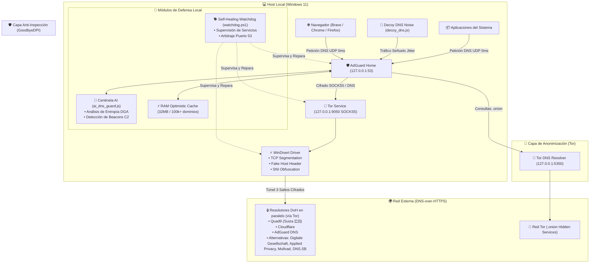

# 🛡️ AdGuard Home + Tor DNS Privacy Fortress

[](LICENSE)
[]()
[]()
[]()
[]()
[](https://github.com/jpscalero/adguardhome-tor-dns-fortress/actions/workflows/main.yml)

> **Arquitectura de Máxima Privacidad y Evasión Anti-Censura para Windows 11 / 10:**  
> Servidor DNS local **AdGuard Home** ultra-blindado, canalizado al 100% a través de **Tor SOCKS5**, con evasión **GoodbyeDPI**, centinela **IA en tiempo real**, **generador de tráfico señuelo** y **watchdog autorreparable**.

> [!TIP]
> 🔰 **¿Nunca has usado GitHub ni PowerShell?**
>
> Sigue la **[Guía de instalación fácil para principiantes](docs/INSTALACION-FACIL.md)**.
> Te dice qué descargar, dónde descomprimirlo y qué botón pulsar en cada
> momento; al final solo tienes que hacer doble clic en `INSTALAR.cmd`. No hace
> falta saber programar.

---

## 🏛️ Diagrama de Arquitectura

> 📖 *Para el modelo de amenazas detallado y el diseño formal de seguridad, consulta [docs/ARCHITECTURE.md](docs/ARCHITECTURE.md) y la [Wiki Oficial](https://github.com/jpscalero/adguardhome-tor-dns-fortress/wiki/Arquitectura-y-Flujo-de-Datos).*



---

## ✨ Características Principales

| Módulo | Función y Beneficio |
| :--- | :--- |
| **🧅 Túnel Tor SOCKS5 Integral** | Todas las peticiones DoH viajan a través de 3 saltos cifrados por la red Tor. Tu ISP jamás ve a qué servidores DNS consultas ni los dominios que visitas. |
| **🌍 Resolutores DoH en paralelo** | Consultas de carrera (`parallel mode`) a Quad9 (Suiza), Cloudflare y AdGuard DNS, con alternativas multijurisdiccionales documentadas (Digitale Gesellschaft, Applied Privacy, Mullvad, DNS.SB). |
| **⚡ Caché Optimista de Alta Velocidad** | 32 MB de RAM para más de 100.000 dominios. Respuestas instantáneas en 0 ms para dominios recurrentes, refrescando en segundo plano sin latencia de usuario. |
| **🛡️ Evasión de DPI (GoodbyeDPI)** | Segmentación a nivel de kernel de paquetes TCP y ofuscación de SNI para eludir firewalls gubernamentales, inspección profunda del ISP y censura. |
| **🛠️ Solución Nativa Puerto 53 Windows 11** | Incluye el script de arbitraje que neutraliza el secuestro de `0.0.0.0:53 UDP` por el servicio `SharedAccess` (ICS / Hyper-V Default Switch). |
| **🤖 Centinela AI en Tiempo Real** | Script Node.js que analiza el query log en vivo, calcula entropía de Shannon (detección de malware DGA) y vigila balizas C2 periódicas. |
| **🎲 Generador de Tráfico Señuelo (Decoy)** | Inyecta ruido estadístico y consultas aleatorias con jitter a sitios neutrales y académicos para romper el perfilado de hábitos de navegación. |
| **🐕 Watchdog Autorreparable** | Servicio supervisor en segundo plano que vigila el estado de Tor, AdGuard Home y GoodbyeDPI, reiniciándolos automáticamente ante fallos. |
| **🌱 Resolutor recursivo propio (Unbound)** | Perfil `privacy`: resuelve desde la raíz con validación DNSSEC local, sin delegar en Quad9/Cloudflare. Ningún tercero ve el patrón de consultas. |
| **🔐 Capa anti-manipulación** | ACL de solo lectura, recuperación automática de servicios, watchdog con repetición cada 5 min, guardián cada 10 min y manifiesto SHA256 de los scripts. |
| **🕵️ Privacidad del navegador** | Firefox con fingerprint uniforme (zona horaria UTC, idioma en-US) y cookies aisladas; Chrome/Edge sin cookies de terceros ni WebRTC directo. |
| **🪟 Perfiles por edición de Windows** | Detecta Home, Pro, Education o Enterprise y aplica solo el hardening que esa edición soporta, sin romper el núcleo DNS/Tor. |

---

## 🪟 Compatibilidad por edición de Windows y Ethernet

El instalador detecta la edición real del sistema y adapta el hardening:

| Edición | Perfil | Qué añade sobre el núcleo |
|---|---|---|
| **Home** | Básico | Solo el núcleo DNS/Tor/firewall/failsafe/watchdog. |
| **Pro** | Avanzado | Registro de firewall, registro DNS Client, auditoría Defender (ASR/NP/CFA), App Control, BitLocker e Hyper-V/Sandbox en lectura. |
| **Education** | Educación | Todo lo de Pro más AppLocker, Credential Guard y Application Guard en lectura. |
| **Enterprise** | Empresa | Todo lo de Education más el informe consolidado `edition-hardening.report.json`. |

La edición real manda: un equipo Home no puede ejecutar módulos de Pro,
Education o Enterprise, y Pro no puede ejecutar los de Education/Enterprise, ni
siquiera forzando `-Edition` a mano (el perfil se recorta y se avisa).

**¿Funciona por Ethernet?** Sí. El instalador configura todos los adaptadores
físicos activos, incluido Ethernet; el firewall bloquea por puerto (no por
interfaz) y AdGuard/Tor escuchan en loopback. Solo hay que revisar casos
especiales como adaptadores virtuales, redes IPv6-only, portales cautivos o
VPN que cambien el DNS. La matriz completa, los comandos de comprobación y esos
casos están en **[docs/EDICIONES-WINDOWS.md](docs/EDICIONES-WINDOWS.md)**.

---

## 🚀 Despliegue Rápido (1-Click)

> 🔰 **¿Es tu primera vez?** Usa la **[Guía de instalación fácil](docs/INSTALACION-FACIL.md)**.
> Descarga el ZIP del repositorio, descomprímelo en `C:\fortaleza` y haz doble
> clic en `INSTALAR.cmd`. La guía explica también cómo instalar AdGuard Home,
> Tor y GoodbyeDPI paso a paso.

### Instalación fácil (Windows, sin consola)

1. Descarga el repositorio con **Code → Download ZIP** y descomprímelo en
   `C:\fortaleza`.
2. Instala AdGuard Home y completa su asistente (crea tu usuario y contraseña).
3. Descomprime Tor en `C:\Tor` y, opcionalmente, GoodbyeDPI en `C:\GoodbyeDPI`.
4. Haz doble clic en `INSTALAR.cmd` y sigue las instrucciones.

Para comprobar el estado en cualquier momento, doble clic en `COMPROBAR.cmd`.
Para deshacer los cambios, doble clic en `DESINSTALAR.cmd`.

### Prerrequisitos
1. **Windows 11 o 10 (64-bit)** con PowerShell 5.1 o PowerShell 7+.
2. [AdGuard Home](https://github.com/AdguardTeam/AdguardHome/releases) instalado o descomprimido en `C:\AdGuardHome`.
3. [Tor Expert Bundle](https://www.torproject.org/download/tor/) instalado como servicio (`tor.exe --service install`).
4. [GoodbyeDPI](https://github.com/ValdikSS/GoodbyeDPI) instalado como servicio (`service_install_russia_blacklist.cmd` o similar).
5. [Node.js](https://nodejs.org/) (opcional pero recomendado para el Centinela AI y el Tráfico Señuelo).

### Instalación Automatizada

> **En un equipo nuevo**, usa `INSTALAR.cmd` (o la guía fácil): este instalador
> avanzado asume que AdGuard Home ya tiene un administrador creado en su
> asistente y no genera el hash de la contraseña por sí solo.

Abre una consola de PowerShell como **Administrador** y ejecuta:

```powershell
# Clonar o descargar el repositorio
git clone https://github.com/jpscalero/adguardhome-tor-dns-fortress.git
cd adguardhome-tor-dns-fortress

# Ejecutar el instalador automatizado
powershell.exe -ExecutionPolicy Bypass -File scripts\install_fortress.ps1
```

El instalador:
* Neutraliza el secuestro del puerto 53 en Windows 11.
* Asigna AdGuard Home exclusivamente a `127.0.0.1:53` y `::1:53`.
* Copia la plantilla de configuración blindada `AdGuardHome.template.yaml` si no existe una configuración previa.
* Configura los adaptadores de red de Windows hacia `127.0.0.1`, incluido Ethernet.
* Detecta Windows Home/Pro/Education/Enterprise y aplica el hardening que permite cada edición.
* Aplica el perfil DNS elegido (`-Profile speed|privacy|censorship`); `privacy` despliega Unbound recursivo.
* Uniforma el fingerprint del navegador y aísla cookies (`harden-browser-privacy.ps1`).
* Blinda scripts, servicios y tareas contra manipulación (`protect-fortress.ps1`).
* Registra el Watchdog con repetición cada 5 minutos y su guardián cada 10.
* Ejecuta la suite de verificación de 21 comprobaciones.

Perfil recursivo propio (opcional, recomendado para máxima privacidad):

```powershell
# El ZIP oficial de Unbound se descarga aparte y se verifica su SHA256
powershell -ExecutionPolicy Bypass -File scripts\setup-unbound.ps1 -PackagePath .\unbound-X.Y.Z.zip
powershell -ExecutionPolicy Bypass -File scripts\apply-dns-profile.ps1 -Profile privacy -Restart

# Volver al perfil DoH sobre Tor
powershell -ExecutionPolicy Bypass -File scripts\apply-dns-profile.ps1 -Profile speed -Restart
```

El instalador también acepta `-Profile speed|privacy|censorship`; si eliges
`privacy` sin haber desplegado Unbound, avisa y conserva `speed`.

---

## 🧪 Comprobación y Diagnóstico

Para verificar en cualquier momento que la fortaleza está funcionando al 100%:

```powershell
powershell.exe -ExecutionPolicy Bypass -File scripts\test_fortress.ps1
```

Salida esperada:
```text
==========================================================
   🛡️ FORTRESS HEALTH & SECURITY DIAGNOSTIC SUITE        
==========================================================

   Windows: Windows 11 Pro 24H2 (build 26100) | Professional | Tier 2 - Avanzado
   Hardening de edicion: 7 modulo(s), 0 aviso(s)

[1] Puerto 53 UDP vinculado exclusivamente a AdGuard Home... OK
[2] Túnel Tor SOCKS5 en escucha y salida anónima (127.0.0.1:9050)... OK
[3] Puerto DNS nativo de Tor en escucha (UDP 127.0.0.1:5350)... OK
[4] Resolución DNS local en 127.0.0.1:53 (github.com)... (159ms) OK
[5] Resolución nativa de dominios Tor .onion (Virtual IP 10.x.x.x)... OK
[6] Bloqueo activo de telemetría y dominios de riesgo (NXDOMAIN)... OK
[7] Servicio GoodbyeDPI (Anti-DPI / WinDivert)... OK
[8] Centinela AI de detección DGA/C2 (ai_dns_guard.js)... OK
[9] Generador de tráfico señuelo anti-fingerprinting (decoy_dns.js)... OK
[10] Neutralización de secuestro de puerto 53 (SharedAccess/ICS)... OK
[11] Permisos de config\.env restringidos (sin Usuarios/AppContainer)... OK
[12] Reglas anti-fuga DoT 853 y mDNS 5353 activas... OK
[13] Heartbeat del watchdog reciente (< 120 s)... OK
[14] Tarea programada del failsafe registrada... OK
[15] DoH del navegador desactivado por politica (Chrome/Edge)... OK
[16] Integridad del binario de AdGuardHome (hash registrado)... OK
[17] DNS real de Windows apunta a la fortaleza (127.0.0.1)... OK
[18] Perfil DNS activo y resolutor recursivo propio (Unbound)... OK
[19] Watchdog con repeticion y guardian anti-manipulacion registrados... OK
[20] Directorio protegido y servicios con recuperacion automatica... OK
[21] Integridad de scripts y puertos sensibles cerrados al exterior... OK

==========================================================
   ✅ TODAS LAS PRUEBAS SUPERADAS (21/21): FORTALEZA 100% ACTIVA
==========================================================
```

---

## ⚠️ Riesgos Conocidos y Limitaciones Operativas

Antes de desplegar la fortaleza en entornos de producción o estaciones de juego diario, ten en cuenta los siguientes aspectos técnicos:

1. **Impacto de GoodbyeDPI / WinDivert en Anticheats y EDRs**:
   - GoodbyeDPI utiliza el driver de filtrado de paquetes a nivel de kernel [WinDivert](https://reqrypt.org/windivert.html).
   - Algunos sistemas antitrampas de videojuegos modernos (e.g. *Vanguard*, *Easy Anti-Cheat*, *BattlEye*) o soluciones EDR corporativas pueden detectar la presencia o inyección de paquetes de WinDivert como actividad anómala o conflicto de hooks. Si experimentas incompatibilidades, puedes pausar o desinstalar el servicio GoodbyeDPI sin afectar a la resolución DNS local por Tor.
2. **Latencia Inicial de Resolución DNS por Tor**:
   - Las consultas DNS que pasan a través de los tres saltos de la red Tor experimentan una latencia típica de entre **200 ms y 800 ms** en la primera consulta (miss de caché).
   - No obstante, gracias a la **Caché Optimista en RAM** (32 MB / 100.000+ registros), las consultas posteriores a dominios frecuentes se resuelven de forma instantánea en **0 ms**, refrescando en segundo plano sin penalizar la experiencia de navegación del usuario.
3. **Bloqueo Preventivo de TLDs de Alto Riesgo (`.zip`, `.mov`, etc.)**:
   - La configuración por defecto bloquea dominios que emplean TLDs frecuentemente asociados con campañas de phishing y suplantación de extensiones de archivos (`.zip`, `.mov`, `.country`, `.kim`, `.gdn`, `.stream`, etc.). Si necesitas acceder a algún sitio corporativo legítimo bajo estos TLDs, puedes añadir una regla de excepción en `Filtros -> Reglas personalizadas` en el panel web de AdGuard Home (ej: `@@||ejemplo.zip^`).

---

## 📁 Estructura del Repositorio

```text
adguardhome-tor-dns-fortress/
├── config/
│   ├── AdGuardHome.template.yaml    # Configuración maestra blindada de AdGuard Home
│   ├── torrc.template                # Configuración endurecida del servicio Tor
│   ├── unbound.conf.template         # Resolutor recursivo: solo loopback + DNSSEC
│   └── .env.example                 # Variables de entorno y credenciales de ejemplo
├── scripts/
│   ├── install_fortress.ps1         # Instalador automatizado para Windows 11/10
│   ├── test_fortress.ps1            # Suite de comprobación de salud y diagnósticos
│   ├── watchdog.ps1                 # Watchdog de supervisión y autorrecuperación
│   ├── windows-edition.ps1          # Detección de Home/Pro/Education/Enterprise
│   ├── apply-edition-hardening.ps1  # Hardening reversible según la edición
│   ├── ai_dns_guard.js              # Centinela AI de detección de amenazas y DGA
│   ├── decoy_dns.js                 # Generador de tráfico señuelo y ofuscación
│   ├── setup-unbound.ps1            # Instala el resolutor recursivo (hash verificado)
│   ├── apply-dns-profile.ps1        # Perfiles privacy / speed / censorship
│   ├── protect-fortress.ps1         # ACL, servicios, watchdog, firewall, integridad
│   ├── watchdog-guard.ps1           # Resucita el watchdog y repara reglas/servicios
│   ├── integrity-check.ps1          # Manifiesto SHA256 y restauración
│   └── harden-browser-privacy.ps1   # Fingerprint uniforme y cookies aisladas
├── launchers/
│   ├── start_watchdog.vbs           # Lanzador silencioso en segundo plano para Watchdog
│   ├── start_ai_guard.vbs           # Lanzador silencioso para Centinela AI
│   └── start_decoy.vbs              # Lanzador silencioso para Tráfico Señuelo
├── docs/
│   ├── ARCHITECTURE.md              # Documentación técnica y modelo de amenazas
│   ├── EDICIONES-WINDOWS.md         # Matriz por edición y funcionamiento por Ethernet
│   └── WINDOWS_PORT_53_FIX.md       # Explicación a fondo del fix para SharedAccess
├── tools/                           # Scripts utilitarios para migración y hardening avanzado
│   ├── build_master_fortress.js     # Constructor de configuración unificada
│   ├── apply_full_frontier_hardening.js # Optimizador TLS local y amnesic logs
│   ├── apply_maximum_hardening.js   # Inyector de protección Bogus NXDOMAIN y TTL
│   ├── apply_server_security_privacy.js # Restricciones de red privada y rate limiting
│   └── update_adguard_settings.js   # Actualizador selectivo de reglas y bootstraps
├── CHANGELOG.md                     # Registro detallado de versiones y correcciones
├── CONTRIBUTING.md                  # Guía de contribución y estándares del código
├── SECURITY.md                      # Política de seguridad y reporte de vulnerabilidades
├── .gitignore                       # Protección estricta de credenciales, logs y claves
├── LICENSE                          # Licencia MIT
└── package.json                     # Metadatos del proyecto
```

---

## 📚 Wiki Oficial y Documentación Completa

Toda la documentación técnica exhaustiva está disponible en la **[Wiki Oficial de GitHub](https://github.com/jpscalero/adguardhome-tor-dns-fortress/wiki)**:

* 📖 **[Manual Maestro Integral de la Fortaleza (wiki-adguard)](https://github.com/jpscalero/adguardhome-tor-dns-fortress/wiki/wiki-adguard)**: Filosofía, modelo de amenazas, diagramas y configuración completa.
* 🏛️ **[Arquitectura y Flujo de Datos](https://github.com/jpscalero/adguardhome-tor-dns-fortress/wiki/Arquitectura-y-Flujo-de-Datos)**: Diagrama de secuencia temporal, caché optimista en RAM y ciclo de paquetes.
* 🔒 **[Criptografía DNSSEC & Bogus NXDOMAIN](https://github.com/jpscalero/adguardhome-tor-dns-fortress/wiki/Criptografia-DNSSEC-y-Seguridad-Criptografica)**: Cadena de confianza (KSK/ZSK/RRSIG) y neutralización del secuestro por ISPs.
* 🛠️ **[Solución Definitiva al Puerto 53 en Windows 11](https://github.com/jpscalero/adguardhome-tor-dns-fortress/wiki/Solucion-Puerto-53-Windows-11)**: Ingeniería inversa de `ipnathlp.dll`, uso de `IcsDnsEnabled` y arbitraje de sockets.
* 🤖 **[Centinela AI y Tráfico Señuelo](https://github.com/jpscalero/adguardhome-tor-dns-fortress/wiki/Centinela-AI-y-Trafico-Senuelo)**: Algoritmo de Entropía de Shannon para DGA, balizas C2 y jitter aleatorio (20-55s).
* 🎯 **[Listas Negras y Feeds de Amenazas](https://github.com/jpscalero/adguardhome-tor-dns-fortress/wiki/Listas-Negras-y-Feeds-de-Ciberinteligencia)**: Directorio de listas activas, sintaxis avanzada y feeds dinámicos (URLhaus/ThreatFox).
* 🌐 **[Hardening de Navegadores y Sistemas](https://github.com/jpscalero/adguardhome-tor-dns-fortress/wiki/Hardening-Navegadores-y-Sistemas)**: Encrypted Client Hello (ECH), desactivación de LLMNR, NetBIOS y WPAD en Windows.
* 📡 **[Integración en Router y Dispositivos Móviles](https://github.com/jpscalero/adguardhome-tor-dns-fortress/wiki/Integracion-en-Router-y-Dispositivos-Moviles)**: Protección para toda la LAN (Smart TVs, móviles, consolas) y VPN móvil (WireGuard/Tailscale).
* ⚡ **[Benchmarks y Pruebas de Rendimiento](https://github.com/jpscalero/adguardhome-tor-dns-fortress/wiki/Benchmarks-y-Pruebas-de-Rendimiento)**: Latencia en 0 ms con caché optimista, impacto de memoria (< 180 MB) y scripts de prueba.
* 🚨 **[Runbook de Operaciones y Disaster Recovery](https://github.com/jpscalero/adguardhome-tor-dns-fortress/wiki/Runbook-de-Operaciones-y-Disaster-Recovery)**: Procedimientos de mantenimiento, rotación de Tor y playbooks ante incidentes.

---

## 💚 Apoyar el proyecto (Revolut)

El proyecto es y seguirá siendo open source bajo licencia MIT. Si te resulta
útil, puedes donar directamente a mi cuenta de Revolut, sin tiendas, licencias
ni pedidos de por medio:

**https://revolut.me/jpscalero**

El botón **Sponsor** de GitHub usa el enlace declarado en
[`.github/FUNDING.yml`](.github/FUNDING.yml). No hay pasarela propia, ni carrito,
ni datos de clientes: la donación se hace en Revolut y este repositorio no
recibe nada.

## 🧭 Canales oficiales (todo en GitHub)

| Qué | Dónde |
|---|---|
| Código y documentación | Este repositorio y [`docs/`](docs/) |
| Descargas | [Releases](https://github.com/jpscalero/adguardhome-tor-dns-fortress/releases) |
| Soporte comunitario | [Issues](https://github.com/jpscalero/adguardhome-tor-dns-fortress/issues) |
| Donaciones | [Revolut](https://revolut.me/jpscalero) |

No hay página web externa: la portada, la documentación técnica y las novedades
viven en el README, en `docs/` y en las releases de GitHub.

## 👤 Autor
* **jpscalero** - [GitHub](https://github.com/jpscalero)

## 📄 Licencia y Políticas
* **Licencia**: Licencia MIT. Consulta el archivo [LICENSE](LICENSE) para más detalles.
* **Historial de Cambios**: Consulta [CHANGELOG.md](CHANGELOG.md).
* **Seguridad y Reportes**: Consulta [SECURITY.md](SECURITY.md).
* **Guía de Contribución**: Consulta [CONTRIBUTING.md](CONTRIBUTING.md).

---

## 🧭 Estado del proyecto y fases

| Fase | Contenido | Estado |
|---|---|---|
| 1. Profesionalización | CI real (PowerShell, Node, config, secretos, docs), plantillas de issues y PR, `NOTICE`, `docs/LIMITS.md` | ✅ |
| 2. Correcciones de producción | Failsafe de red, ACL de `config/.env`, Node portable con SHA256, lanzadores `.cmd`/`.vbs` y watchdog sin bucles | ✅ |
| 3. Privacidad y endurecimiento | `AI_MODE`, aislamiento de circuitos Tor, firewall 853/mDNS, DoH del navegador, suite de 21 pruebas | ✅ |
| 4. Operación | Desinstalador con rollback, tests sin red, `-DryRun` en el instalador, perfil Docker/Linux | ✅ |
| 5. Independencia y protección | Unbound recursivo, perfiles DNS, capa anti-manipulación, integridad SHA256 y privacidad del navegador | ✅ |

## 🔒 Privacidad del centinela: AI_MODE

El centinela necesita ver dominios para detectar DGA y beaconing, y eso choca con
la promesa de privacidad. `AI_MODE` hace el compromiso explícito:

| Modo | Qué sale del equipo | Detección | Uso recomendado |
|---|---|---|---|
| `off` | Nada | Heurística local | Máxima privacidad |
| `local` | Nada (modelo en `127.0.0.1:11434`) | Modelo local | Con GPU/RAM suficiente |
| `aggregate` *(por defecto)* | Hash con sal + entropía, longitud y TLD | Media | Uso diario |
| `full` | Dominio completo a Gemini | Alta | Depuración |

## 🧪 Verificación

```powershell
# Suite completa (requiere administrador)
powershell -ExecutionPolicy Bypass -File scripts\test_fortress.ps1

# Tests unitarios del centinela (sin red, sin admin, sin credenciales)
node --test tests/

# Invariantes de configuración (YAML + garantías de privacidad)
python tools/validate_fortress_config.py
```

## 🆘 Si algo falla

1. **Sin Internet tras un cambio**: `powershell -ExecutionPolicy Bypass -File scripts\failsafe-dns.ps1 -Trace`
2. **Sin resolución en general**: revisa `failsafe.log`; el modo emergencia deja DNS público.
3. **Volver atrás del todo**: `scripts\uninstall_fortress.ps1` (conserva datos salvo `-RemoveData`).
4. Guía completa en [docs/TROUBLESHOOTING.md](docs/TROUBLESHOOTING.md).

## 📚 Documentación

| Documento | Contenido |
|---|---|
| [docs/INSTALACION-FACIL.md](docs/INSTALACION-FACIL.md) | Instalación desde cero para principiantes |
| [docs/EDICIONES-WINDOWS.md](docs/EDICIONES-WINDOWS.md) | Home/Pro/Education/Enterprise, módulos y Ethernet |
| [docs/ARCHITECTURE.md](docs/ARCHITECTURE.md) | Diseño y flujo de datos |
| [docs/LIMITS.md](docs/LIMITS.md) | Qué NO protege la fortaleza |
| [docs/THREAT-MODEL.md](docs/THREAT-MODEL.md) | Modelo de amenazas |
| [docs/TROUBLESHOOTING.md](docs/TROUBLESHOOTING.md) | Fallos típicos y solución |
| [docs/ROADMAP.md](docs/ROADMAP.md) | Qué falta y en qué orden |
| [docs/ROADMAP-3.0.0.md](docs/ROADMAP-3.0.0.md) | Plan por versiones: 2.0.x → 3.0.0, con criterios de salida |
| [docs/LINUX.md](docs/LINUX.md) | Perfil Linux/Docker |
