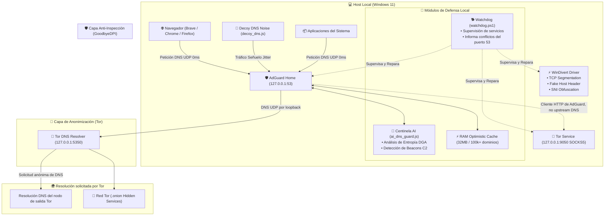

# 🛡️ AdGuard Home + Tor DNS Privacy Fortress

[](LICENSE)
[]()
[]()
[]()
[]()
[](https://github.com/jpscalero/adguardhome-tor-dns-fortress/actions/workflows/main.yml)

> **Arquitectura de Máxima Privacidad y Evasión Anti-Censura para Windows 11 / 10:**  
> Servidor DNS local **AdGuard Home** que envía consultas DNS convencionales A/AAAA/PTR a Tor mediante su DNSPort local, sin fallback DNS directo. El bloqueo de TCP/UDP 53 no intercepta DoH/DoT por HTTPS/TLS ni consultas por IP directa; esas aplicaciones requieren una política propia. Incluye panel local, proxy SOCKS5 para el cliente HTTP de AdGuard Home, GoodbyeDPI opcional, centinela y watchdog.

---

## 🏛️ Diagrama de Arquitectura

> 📖 *Para el modelo de amenazas detallado y el diseño formal de seguridad, consulta [docs/ARCHITECTURE.md](docs/ARCHITECTURE.md) y la [Wiki Oficial](https://github.com/jpscalero/adguardhome-tor-dns-fortress/wiki/Arquitectura-y-Flujo-de-Datos).*



---

## ✨ Características Principales

| Módulo | Función y Beneficio |
| :--- | :--- |
| **🧅 Resolución DNS por Tor** | AdGuard Home envía A/AAAA/PTR a `127.0.0.1:5350` (Tor DNSPort). Si Tor falla, no se consulta un DNS público. Tor DNSPort no admite todos los tipos de consulta ni aporta validación DNSSEC. |
| **🔒 Panel de administración local** | Escucha solo en `127.0.0.1:3000`. TLS y los protocolos DNS remotos quedan desactivados hasta configurar un certificado válido. |
| **⚡ Caché Optimista de Alta Velocidad** | 32 MB de RAM para más de 100.000 dominios. Respuestas instantáneas en 0 ms para dominios recurrentes, refrescando en segundo plano sin latencia de usuario. |
| **🛡️ Evasión de DPI (GoodbyeDPI)** | Segmentación a nivel de kernel de paquetes TCP y ofuscación de SNI para eludir firewalls gubernamentales, inspección profunda del ISP y censura. |
| **🛠️ Conflictos del puerto 53** | El instalador informa qué proceso ocupa el puerto y se detiene sin terminar procesos ni desactivar servicios compartidos de Windows. |
| **🤖 Centinela AI en Tiempo Real** | Script Node.js que analiza el query log en vivo, calcula entropía de Shannon (detección de malware DGA) y vigila balizas C2 periódicas. |
| **🎲 Generador de Tráfico Señuelo (Decoy)** | Inyecta ruido estadístico y consultas aleatorias con jitter a sitios neutrales y académicos para romper el perfilado de hábitos de navegación. |
| **🐕 Watchdog Autorreparable** | Servicio supervisor en segundo plano que vigila el estado de Tor, AdGuard Home y GoodbyeDPI, reiniciándolos automáticamente ante fallos. |

---

## 🚀 Despliegue Rápido (1-Click)

### Prerrequisitos
1. **Windows 11 o 10 (64-bit)** con PowerShell 5.1 o PowerShell 7+.
2. [AdGuard Home](https://github.com/AdguardTeam/AdguardHome/releases) instalado en la carpeta indicada por `-TargetDir` (por defecto `C:\AdGuardHome`) y ejecutándose como servicio `AdGuardHome`.
3. Un hash bcrypt para el usuario administrador del panel. Usa `htpasswd -B -n admin` para generarlo con entrada interactiva y copia solo la parte del hash. El instalador lo solicita o acepta `-AdminPasswordHash`. Consulta [la guía oficial de AdGuard Home](https://github.com/AdguardTeam/AdGuardHome/wiki/Configuration#reset-web-password).
4. [Tor Expert Bundle](https://www.torproject.org/download/tor/) instalado y ejecutándose con SOCKS en `127.0.0.1:9050` y DNSPort UDP en `127.0.0.1:5350`. La plantilla `config/torrc.template` debe haberse cargado y Tor reiniciado.
5. [GoodbyeDPI](https://github.com/ValdikSS/GoodbyeDPI) instalado como servicio (`service_install_russia_blacklist.cmd` o similar).
6. [Node.js](https://nodejs.org/) (opcional pero recomendado para el Centinela AI y el Tráfico Señuelo).

### Instalación Automatizada
Abre una consola de PowerShell como **Administrador** y ejecuta:

```powershell
# Clonar o descargar el repositorio
git clone https://github.com/jpscalero/adguardhome-tor-dns-fortress.git
cd adguardhome-tor-dns-fortress

# Ejecutar el instalador automatizado
powershell.exe -ExecutionPolicy Bypass -File scripts\install_fortress.ps1
```

La plantilla contiene un marcador de hash, nunca una contraseña ficticia utilizable. El instalador pide un hash bcrypt válido antes de escribirla y guarda respaldo si reemplaza una configuración existente.

Si quieres que el instalador copie la plantilla de Tor, indica la ruta exacta del `torrc` usado por el servicio. El instalador crea una copia de respaldo antes de reemplazarlo con `-Force`; después hay que reiniciar Tor y ejecutar el instalador otra vez:

```powershell
powershell.exe -ExecutionPolicy Bypass -File scripts\install_fortress.ps1 -TorConfigPath "C:\ruta\del\servicio\torrc"
```

El instalador:
* Comprueba que Tor, AdGuard Home y los puertos requeridos están disponibles; informa conflictos del puerto 53 y nunca termina procesos ajenos.
* Copia la plantilla de configuración solo si no existe (o con `-Force`, tras guardar una copia de respaldo).
* Mantiene el panel de administración en `127.0.0.1:3000` y el DNS local en loopback.
* Configura los adaptadores de red de Windows hacia `127.0.0.1` solo después de verificar la resolución local.
* Registra la tarea programada del Watchdog autorreparable.
* Ejecuta la suite de verificación de diagnóstico.

---

## 🧪 Comprobación y Diagnóstico

Ejecuta primero las comprobaciones estáticas y después las comprobaciones en vivo:

```powershell
npm test
```

La comprobación en vivo consulta `check.torproject.org` a través del SOCKS local y solo pasa si la respuesta tiene `IsTor=true` y una IP válida. Para ejecutar únicamente las comprobaciones que no requieren servicios activos, usa `npm run test:static`.

Salida esperada:
```text
==========================================================
   🛡️ FORTRESS HEALTH & SECURITY DIAGNOSTIC SUITE        
==========================================================

[1] Puerto 53 UDP/TCP vinculado exclusivamente a AdGuard Home... OK
[2] Salida Tor verificada por check.torproject.org... OK (IsTor=true, IP válida)
[3] Puerto DNS nativo de Tor en escucha (UDP 127.0.0.1:5350)... OK
[4] Resolución DNS local en 127.0.0.1:53 (github.com)... (159ms) OK
[5] Resolución DNS local a través de la configuración Tor... OK
[6] Bloqueo activo de telemetría y dominios de riesgo (NXDOMAIN)... OK
[7] Servicio GoodbyeDPI (Anti-DPI / WinDivert)... OK
[8] Centinela AI de detección DGA/C2 (ai_dns_guard.js)... OK
[9] Generador de tráfico señuelo anti-fingerprinting (decoy_dns.js)... OK

==========================================================
   ✅ TODAS LAS PRUEBAS SUPERADAS (10/10): FORTALEZA ACTIVA
==========================================================
```

---

## ⚠️ Riesgos Conocidos y Limitaciones Operativas

Antes de desplegar la fortaleza en entornos de producción o estaciones de juego diario, ten en cuenta los siguientes aspectos técnicos:

1. **Impacto de GoodbyeDPI / WinDivert en Anticheats y EDRs**:
   - GoodbyeDPI utiliza el driver de filtrado de paquetes a nivel de kernel [WinDivert](https://reqrypt.org/windivert.html).
   - Algunos sistemas antitrampas de videojuegos modernos (e.g. *Vanguard*, *Easy Anti-Cheat*, *BattlEye*) o soluciones EDR corporativas pueden detectar la presencia o inyección de paquetes de WinDivert como actividad anómala o conflicto de hooks. Si experimentas incompatibilidades, puedes pausar o desinstalar el servicio GoodbyeDPI sin afectar a la resolución DNS local por Tor.
2. **Latencia Inicial de Resolución DNS por Tor**:
   - Las consultas DNS que pasan a través de los tres saltos de la red Tor experimentan una latencia típica de entre **200 ms y 800 ms** en la primera consulta (miss de caché).
   - No obstante, gracias a la **Caché Optimista en RAM** (32 MB / 100.000+ registros), las consultas posteriores a dominios frecuentes se resuelven de forma instantánea en **0 ms**, refrescando en segundo plano sin penalizar la experiencia de navegación del usuario.
3. **Bloqueo Preventivo de TLDs de Alto Riesgo (`.zip`, `.mov`, etc.)**:
   - La configuración por defecto bloquea dominios que emplean TLDs frecuentemente asociados con campañas de phishing y suplantación de extensiones de archivos (`.zip`, `.mov`, `.country`, `.kim`, `.gdn`, `.stream`, etc.). Si necesitas acceder a algún sitio corporativo legítimo bajo estos TLDs, puedes añadir una regla de excepción en `Filtros -> Reglas personalizadas` en el panel web de AdGuard Home (ej: `@@||ejemplo.zip^`).

---

## 📁 Estructura del Repositorio

```text
adguardhome-tor-dns-fortress/
├── config/
│   ├── AdGuardHome.template.yaml    # Configuración maestra blindada de AdGuard Home
│   ├── torrc.template                # Configuración endurecida del servicio Tor
│   └── .env.example                 # Variables de entorno y credenciales de ejemplo
├── scripts/
│   ├── install_fortress.ps1         # Instalador automatizado para Windows 11/10
│   ├── test_fortress.ps1            # Suite de comprobación de salud y diagnósticos
│   ├── watchdog.ps1                 # Watchdog de supervisión y autorrecuperación
│   ├── ai_dns_guard.js              # Centinela AI de detección de amenazas y DGA
│   └── decoy_dns.js                 # Generador de tráfico señuelo y ofuscación
├── launchers/
│   ├── start_watchdog.vbs           # Lanzador silencioso en segundo plano para Watchdog
│   ├── start_ai_guard.vbs           # Lanzador silencioso para Centinela AI
│   └── start_decoy.vbs              # Lanzador silencioso para Tráfico Señuelo
├── docs/
│   ├── ARCHITECTURE.md              # Documentación técnica y modelo de amenazas
│   └── WINDOWS_PORT_53_FIX.md       # Explicación a fondo del fix para SharedAccess
├── tools/                           # Scripts utilitarios para migración y hardening avanzado
│   ├── build_master_fortress.js     # Constructor de configuración unificada
│   ├── apply_full_frontier_hardening.js # Optimizador TLS local y amnesic logs
│   ├── apply_maximum_hardening.js   # Inyector de protección Bogus NXDOMAIN y TTL
│   ├── apply_server_security_privacy.js # Restricciones de red privada y rate limiting
│   └── update_adguard_settings.js   # Actualizador selectivo de reglas y bootstraps
├── CHANGELOG.md                     # Registro detallado de versiones y correcciones
├── CONTRIBUTING.md                  # Guía de contribución y estándares del código
├── SECURITY.md                      # Política de seguridad y reporte de vulnerabilidades
├── .gitignore                       # Protección estricta de credenciales, logs y claves
├── LICENSE                          # Licencia MIT
└── package.json                     # Metadatos del proyecto
```

---

## 📚 Wiki Oficial y Documentación Completa

Toda la documentación técnica exhaustiva está disponible en la **[Wiki Oficial de GitHub](https://github.com/jpscalero/adguardhome-tor-dns-fortress/wiki)**:

* 📖 **[Manual Maestro Integral de la Fortaleza (wiki-adguard)](https://github.com/jpscalero/adguardhome-tor-dns-fortress/wiki/wiki-adguard)**: Filosofía, modelo de amenazas, diagramas y configuración completa.
* 🏛️ **[Arquitectura y Flujo de Datos](https://github.com/jpscalero/adguardhome-tor-dns-fortress/wiki/Arquitectura-y-Flujo-de-Datos)**: Diagrama de secuencia temporal, caché optimista en RAM y ciclo de paquetes.
* 🔒 **[Criptografía DNSSEC & Bogus NXDOMAIN](https://github.com/jpscalero/adguardhome-tor-dns-fortress/wiki/Criptografia-DNSSEC-y-Seguridad-Criptografica)**: Cadena de confianza (KSK/ZSK/RRSIG) y neutralización del secuestro por ISPs.
* 🛠️ **[Solución Definitiva al Puerto 53 en Windows 11](https://github.com/jpscalero/adguardhome-tor-dns-fortress/wiki/Solucion-Puerto-53-Windows-11)**: Ingeniería inversa de `ipnathlp.dll`, uso de `IcsDnsEnabled` y arbitraje de sockets.
* 🤖 **[Centinela AI y Tráfico Señuelo](https://github.com/jpscalero/adguardhome-tor-dns-fortress/wiki/Centinela-AI-y-Trafico-Senuelo)**: Algoritmo de Entropía de Shannon para DGA, balizas C2 y jitter aleatorio (20-55s).
* 🎯 **[Listas Negras y Feeds de Amenazas](https://github.com/jpscalero/adguardhome-tor-dns-fortress/wiki/Listas-Negras-y-Feeds-de-Ciberinteligencia)**: Directorio de listas activas, sintaxis avanzada y feeds dinámicos (URLhaus/ThreatFox).
* 🌐 **[Hardening de Navegadores y Sistemas](https://github.com/jpscalero/adguardhome-tor-dns-fortress/wiki/Hardening-Navegadores-y-Sistemas)**: Encrypted Client Hello (ECH), desactivación de LLMNR, NetBIOS y WPAD en Windows.
* 📡 **[Integración en Router y Dispositivos Móviles](https://github.com/jpscalero/adguardhome-tor-dns-fortress/wiki/Integracion-en-Router-y-Dispositivos-Moviles)**: Protección para toda la LAN (Smart TVs, móviles, consolas) y VPN móvil (WireGuard/Tailscale).
* ⚡ **[Benchmarks y Pruebas de Rendimiento](https://github.com/jpscalero/adguardhome-tor-dns-fortress/wiki/Benchmarks-y-Pruebas-de-Rendimiento)**: Latencia en 0 ms con caché optimista, impacto de memoria (< 180 MB) y scripts de prueba.
* 🚨 **[Runbook de Operaciones y Disaster Recovery](https://github.com/jpscalero/adguardhome-tor-dns-fortress/wiki/Runbook-de-Operaciones-y-Disaster-Recovery)**: Procedimientos de mantenimiento, rotación de Tor y playbooks ante incidentes.

---

## 👤 Autor
* **jpscalero** - [GitHub](https://github.com/jpscalero)

## 📄 Licencia y Políticas
* **Licencia**: Licencia MIT. Consulta el archivo [LICENSE](LICENSE) para más detalles.
* **Historial de Cambios**: Consulta [CHANGELOG.md](CHANGELOG.md).
* **Seguridad y Reportes**: Consulta [SECURITY.md](SECURITY.md).
* **Guía de Contribución**: Consulta [CONTRIBUTING.md](CONTRIBUTING.md).
