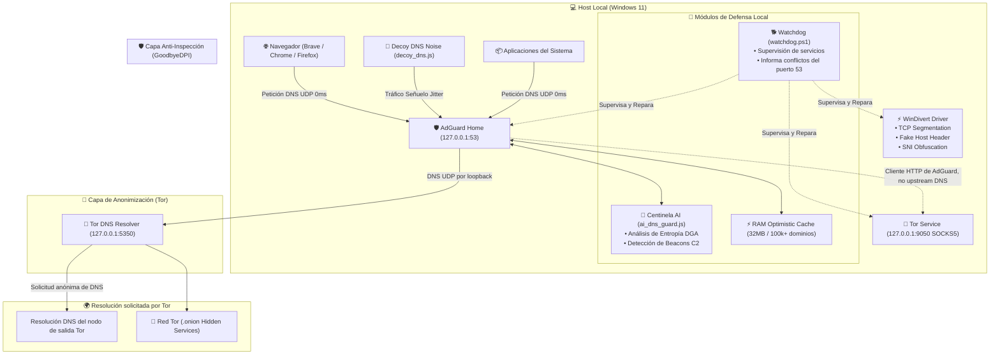

# 🏛️ Arquitectura de Seguridad y Privacidad Multicapa

## Diagrama de Flujo de Datos

---

## Principios Fundamentales del Diseño

### 1. Enrutamiento de DNS clásico por Tor
* **EDNS Client Subnet (ECS) desactivado**: AdGuard Home no añade una subred de cliente a las solicitudes que reenvía.
* **Bloqueo AAAA configurable**: La plantilla desactiva respuestas AAAA; cámbialo solo si tu ruta IPv6 está protegida.
* **Refuse ANY**: Se deniegan automáticamente consultas de tipo `ANY`.

### 2. Anonimización por Multi-Salto
* AdGuard Home envía A/AAAA/PTR a Tor DNSPort en `127.0.0.1:5350`. Tor solicita la resolución de forma anónima; el ISP local ve conexiones de Tor, no el destino DNS final.
* La plantilla deja vacíos `fallback_dns` y `bootstrap_dns`, por lo que no recurre a DNS público directo cuando Tor falla. El instalador bloquea DNS clásico saliente por TCP/UDP 53; ese bloqueo no intercepta DoH/DoT por otros puertos ni consultas por IP directa.
* Tor DNSPort solo atiende A/AAAA/PTR. Esta ruta no ofrece validación DNSSEC completa ni soporte para todos los tipos DNS.
* `http_proxy` se usa para el cliente HTTP de AdGuard Home y no se presenta como mecanismo de proxy para los upstreams DNS.

### 3. Evasión de Inspección Profunda (Anti-DPI)
* **GoodbyeDPI** opera a nivel de paquete en el kernel de Windows a través de `WinDivert`. Fragmenta el handshake inicial TLS e inyecta paquetes SNI desfasados para neutralizar cualquier firewall estatal, corporativo o de ISP que intente registrar las consultas o bloquear sitios web.

### 4. Inteligencia Artificial Centinela y Tráfico Señuelo
* **`ai_dns_guard.js`**: Inspecciona continuamente el log de consultas en memoria. Calcula la entropía de Shannon para detectar dominios DGA (típicos de malware) y analiza la desviación estándar de los intervalos temporales para neutralizar beacons periódicos de troyanos C2.
* **`decoy_dns.js`**: Emite periódicamente consultas a dominios académicos, culturales y de código abierto con jitter aleatorio para frustrar el análisis de perfiles de navegación y correlación temporal de tráfico.
