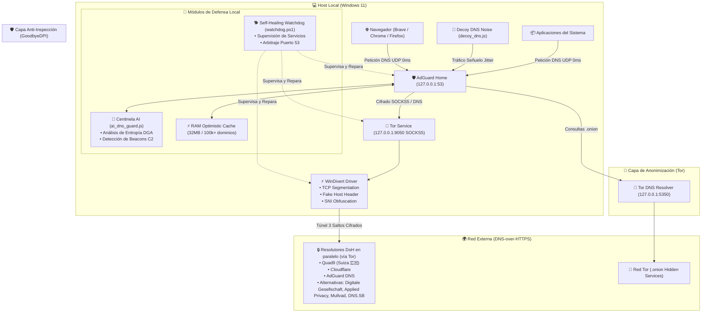

# 🏛️ Arquitectura de Seguridad y Privacidad Multicapa

## Diagrama de Flujo de Datos



---

## Principios Fundamentales del Diseño

### 1. Resistencia a Fugas (Zero-Leak Policy)
* **EDNS Client Subnet (ECS) Desactivado**: Ni tu IP pública ni la subred de tu ISP se transmiten en las cabeceras DNS a los servidores destino.
* **Bloqueo AAAA Forzado**: En entornos donde el proveedor o la VPN no tiene túnel IPv6 completo, las peticiones IPv6 se cancelan de inmediato para evitar bypass de consultas DNS no enrutadas.
* **Refuse ANY**: Se deniegan automáticamente consultas de tipo `ANY` para prevenir amplificación DNS y reconocimiento de infraestructura.

### 2. Anonimización por Multi-Salto
* Ningún resolvedor DNS upstream conoce la IP real del usuario. Todos los paquetes DoH son transmitidos a través del circuito Tor (3 saltos: Entry Guard -> Middle Relay -> Exit Relay).
* Las consultas a servidores suizos y austriacos se ejecutan en modo **Paralelo Competitivo** (`parallel`), aceptando la respuesta criptográficamente verificada más rápida (DNSSEC).

### 3. Evasión de Inspección Profunda (Anti-DPI)
* **GoodbyeDPI** opera a nivel de paquete en el kernel de Windows a través de `WinDivert`. Fragmenta el handshake inicial TLS e inyecta paquetes SNI desfasados para neutralizar cualquier firewall estatal, corporativo o de ISP que intente registrar las consultas o bloquear sitios web.

### 4. Inteligencia Artificial Centinela y Tráfico Señuelo
* **`ai_dns_guard.js`**: Inspecciona continuamente el log de consultas en memoria. Calcula la entropía de Shannon para detectar dominios DGA (típicos de malware) y analiza la desviación estándar de los intervalos temporales para neutralizar beacons periódicos de troyanos C2.
* **`decoy_dns.js`**: Emite periódicamente consultas a dominios académicos, culturales y de código abierto con jitter aleatorio para frustrar el análisis de perfiles de navegación y correlación temporal de tráfico.

---

## Perfil recursivo propio (Fase 5)

El perfil por defecto (`speed`) mantiene el diseño histórico: AdGuard Home envía
DoH por el proxy SOCKS5 de Tor a Quad9, Cloudflare y AdGuard DNS. Eso oculta tu
IP al resolutor, pero el resolutor sigue viendo el dominio y puede correlacionar
patrones entre sesiones.

El perfil `privacy` cierra esa dependencia:

```text
Aplicación -> 127.0.0.1:53 (AdGuard Home)
           -> 127.0.0.1:5335 (Unbound recursivo)
           -> raíz DNS -> TLD -> autoritativo
```

* **Unbound** escucha solo en loopback, valida DNSSEC desde la raíz, aplica
  qname minimisation y no escribe log de consultas.
* **Sin terceros**: ningún resolutor intermedio ve el patrón; solo los
  servidores autoritativos de cada dominio, que ya forma parte de la resolución
  normal de Internet.
* **Coste**: más latencia en caché fría (varias consultas por nombre nuevo) y
  dependencia de la salida 53/UDP. La caché de AdGuard Home sigue absorbiendo
  las consultas repetidas.
* **Conmutación**: `scripts/apply-dns-profile.ps1` reescribe únicamente el
  bloque `FORTRESS-UPSTREAM`, valida con `AdGuardHome.exe --check-config` y
  revierte si algo falla. `-Profile speed` vuelve al DoH.

## Capa anti-manipulación

La fortaleza asume que el equipo puede estar comprometido por malware
oportunista, no por un atacante con control total del kernel:

| Control | Script | Efecto |
|---|---|---|
| ACL de solo lectura | `protect-fortress.ps1` | Usuarios no escriben scripts, lanzadores ni configuración |
| Recuperación de servicios | `protect-fortress.ps1` | `sc failure` reinicia AdGuardHome, tor, GoodbyeDPI y unbound |
| Watchdog con repetición | `install_fortress.ps1` | Si lo matan, el Programador lo relanza en ≤ 5 min |
| Guardián | `watchdog-guard.ps1` | Cada 10 min repara heartbeat, servicios, reglas y hashes |
| Integridad | `integrity-check.ps1` | Manifiesto SHA256 y copia base restaurable |
| Firewall entrante | `protect-fortress.ps1` | Panel, SOCKS, control, DNSPort y Unbound cerrados al exterior |

Ningún control local detiene a un administrador malicioso con acceso físico;
lo que hacen es eliminar las vías triviales y dejar rastro en `guard.log`.
